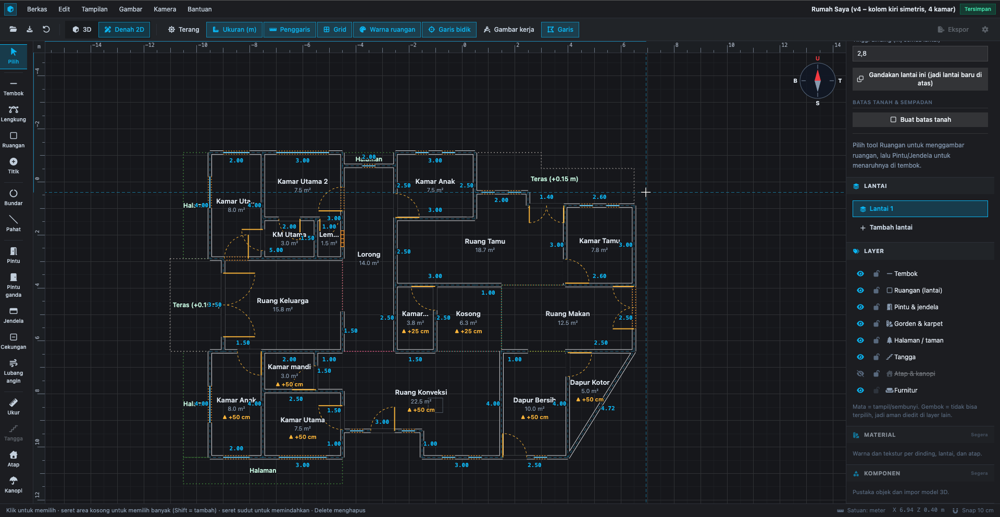
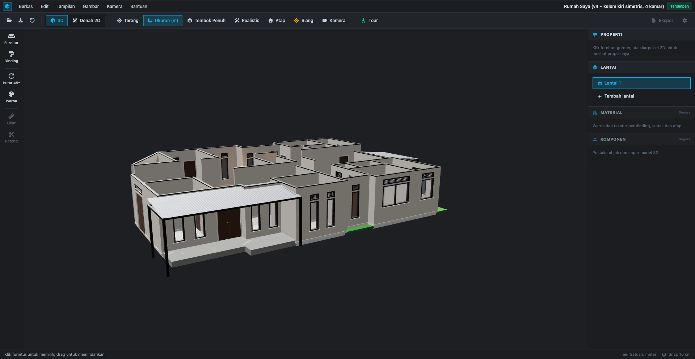
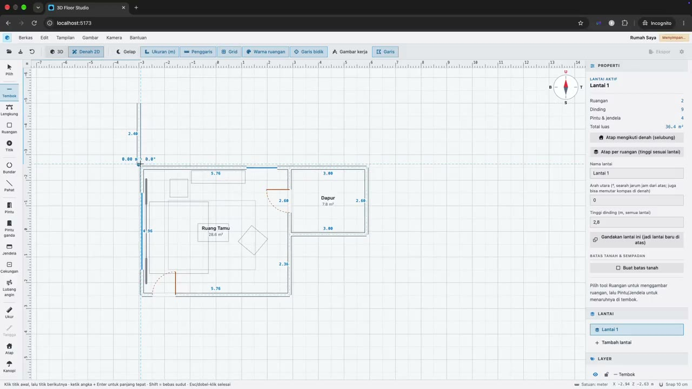
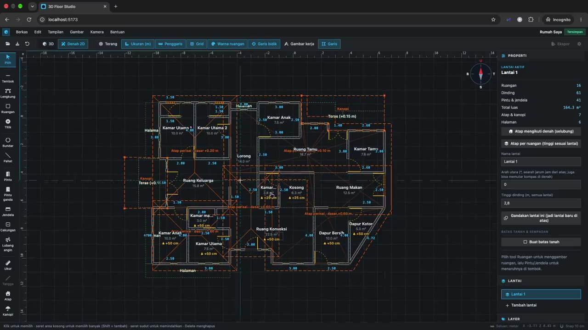

# 3D Floor Studio

An interactive house floor plan app in the browser: draw a plan in the 2D editor, see it instantly as a
3D model, then walk around inside it. Built with **Three.js** and **Vite**, no backend required.

| 2D plan editor | 3D model |
| --- | --- |
|  |  |

## Demo videos

| Drawing a plan | A complete house |
| --- | --- |
| [](assets/demo-1.mp4) | [](assets/demo-2.mp4) |

Click a thumbnail to play the video.

## Features

- **2D editor** — straight and curved walls, rooms, rounded/chamfered corners, doors (single/double), windows,
  niches, vents, stairs, roofs, canopies, terraces, yards, and a measuring tool. Grid and corner snapping,
  undo/redo, rulers, and a *technical drawing* view (end-to-end dimensions, grid axes, door/window schedule).
- **Live 3D** — every plan change rebuilds the model immediately. Multiple floors, raised room floors,
  wall modes (cutaway / full / low), day/night, and a realistic mode (AO + anti-aliasing).
- **Furniture & decor** — furniture catalog, drag and rotate in 3D, change colors/materials, dimension lines between pieces.
- **First-person tour** — walk through the house with collision detection; doors can be passed, and raised floors are climbed automatically.
- **Export** — JSON (backup), DXF for CAD, GLB 3D model, printable sheet, and a quantity/cost estimate table.
- **Autosave** in the browser (`localStorage`), with dark/light theme.

## Getting started

Requires Node.js 18+.

```bash
npm install
npm run dev       # http://localhost:5173
npm test          # unit tests (geometry, plan model, measurements, etc.)
npm run build     # production build in dist/
npm run preview   # preview the build
```

## Usage

| Mode | What it does |
| --- | --- |
| **3D** | Orbit/zoom, move furniture, catalog, change colors, day/night, wall modes. |
| **Tour** | **Tour** button in 3D. `W A S D`/arrows = walk, drag mouse = look, `Shift` = run, `Esc` = exit. |
| **2D plan** | Draw rooms and walls, place doors/windows, drag corners, edit properties in the right panel. |

### 2D editor shortcuts

| Key | Tool | Key | Tool |
| --- | --- | --- | --- |
| `V` | Select | `D` / `G` | Door / double door |
| `W` | Wall | `N` | Window |
| `A` | Curved wall | `E` / `F` | Niche / vent |
| `R` | Room | `M` | Measure |
| `P` | Add/remove vertex | `T` / `K` | Roof / canopy |
| `C` / `X` | Round / chamfer corner | `U` / `Y` / `H` | Stairs / terrace / yard |

Also: `Del` delete · `Ctrl/⌘+Z` undo · `Ctrl/⌘+Shift+Z` redo · scroll = zoom · drag empty area or
`Space`+drag = pan · `L` outline-only view.

Snaps to a 10 cm grid (5 cm when zoomed in) and to existing corners; hold `Alt` to disable snapping and
`Shift` while drawing a wall for free angles. For precise lengths (e.g. 1.25 m), type a number and press `Enter`
while drawing a wall, or select a wall and fill in **Length** in the right panel.

**Split levels within one building floor** (e.g. a room whose floor is 25 cm higher): select the room in the
2D editor and set **Floor height (cm)**. The room becomes a platform in 3D and furniture inside it is raised too.

> Use the download/open buttons in the header to save and load plans as JSON files.
> Keep personal plans in a local `private-plans/` folder; it is git-ignored and never committed.

## Project structure

```
index.html                static UI markup (3D + 2D editor)
src/
  main.js                 the only place that wires all modules together
  config.js               camera, themes, color palette, floor/wall options
  data/house.json         sample plan loaded on first run
  plan/                   plan MODEL (no three.js/DOM): Plan, geometry, stairs, dxf, quantities, autosave
  scene/                  3D built from Plan: House3D, wallBuilder, textures, lighting
  editor/                 2D editor on a <canvas>: PlanEditor, tools, render, hit, Viewport
  furniture/              registry + types/*.js, Furniture, FurnitureManager, Selection
  interaction/            PointerController (3D) and TourController
  tour/                   collision detection for Tour mode
  dimensions/             dimension lines between furniture
  ui/                     UI components, one responsibility each
legacy/                   old single-file prototypes, kept for reference
```

## Development

- **New furniture type:** copy `src/furniture/types/plant.js`, edit it, and register it in `registry.js`.
  If it has a `catalog`, it appears in the catalog automatically.
- **Furniture in the house:** an entry in `furniture` in `house.json` (`floor`, `type`, `position: [x, z]`, `rotation` in degrees).
- **Dimension line:** `{ "from": "<id>", "to": "<id>" }` in `dimensions`.
- **Plan:** draw in the 2D editor, or edit `floors[]` in the JSON (`[x, z]` coordinates in meters).

### Architecture rules

- `plan/` imports neither three.js nor the DOM; all plan changes go through `Plan` methods.
- `scene/` and `editor/` only *read* the Plan and listen to its events; they do not import each other.
- One user action = one `plan.checkpoint()` (for undo), then one or more mutations.
- Only `main.js` wires modules together.

## Tech stack

[Three.js](https://threejs.org) · [Vite](https://vite.dev) · [Tailwind CSS](https://tailwindcss.com) ·
[Font Awesome](https://fontawesome.com) · [Vitest](https://vitest.dev)

## Contributing

Issues and pull requests are welcome. Run `npm test` before opening a PR, and see the architecture rules above.

## License

[MIT](LICENSE) © Iip Jaelani
